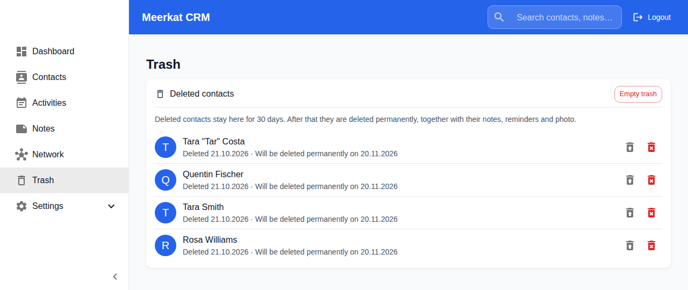
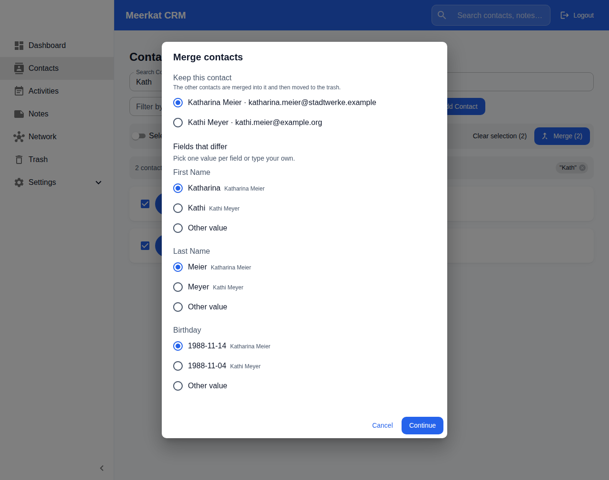
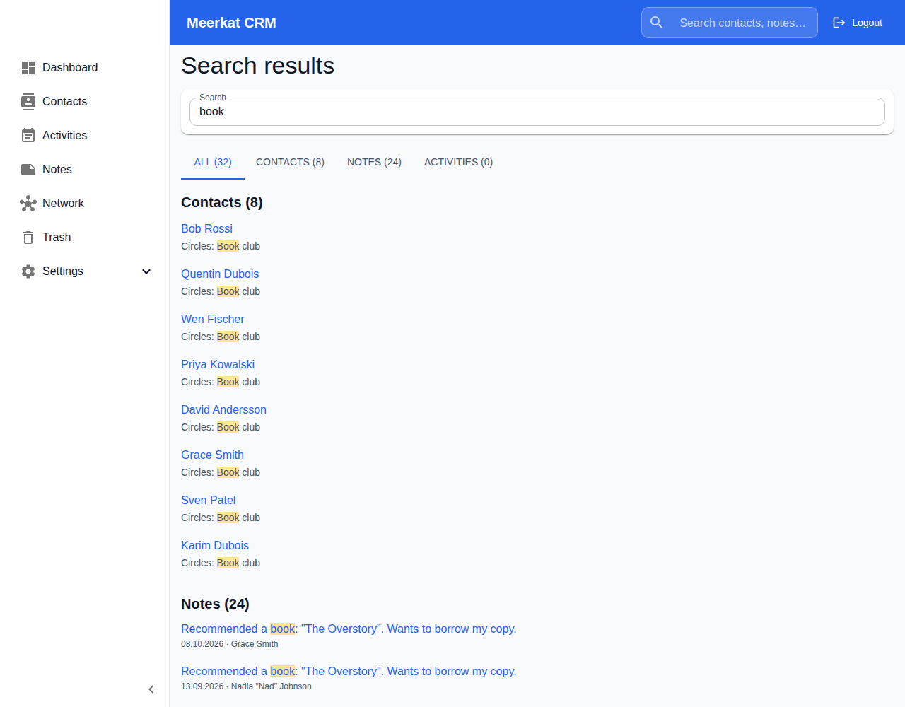
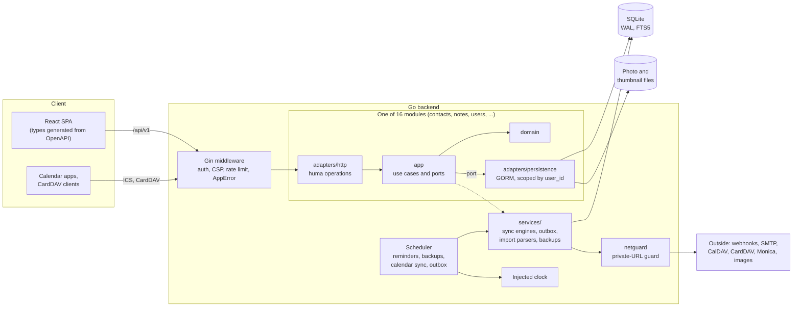

# Differences to upstream

How this fork ([omarkohl/meerkat-crm](https://github.com/omarkohl/meerkat-crm), branch `omk`)
differs from [fbuchner/meerkat-crm](https://github.com/fbuchner/meerkat-crm) `main`. It describes
the **current** difference, not the history ([CHANGELOG.md](CHANGELOG.md) has that). When upstream
takes a change, its entry is deleted. For branches, versions and releases see
[fork.md](docs/development/fork.md).

Last compared with upstream: `0c2aaab` (after v1.7.0). Full diff:
[`main...omk`](https://github.com/fbuchner/meerkat-crm/compare/main...omarkohl:meerkat-crm:omk) (765
files, +93.7k and -27.1k lines; see [Size of the diff](#size-of-the-diff)).

To try the fork, follow the installation instructions in the [README](README.md#installation). They
are adapted to the fork (images from `ghcr.io/omarkohl`).

Issue links in [CHANGELOG.md](CHANGELOG.md) point to issues of the fork (`omarkohl/meerkat-crm`),
not of upstream.

## Summary

The fork keeps upstream's product and its wire format. It adds features, a hexagonal backend
structure with a generated API contract, and a much larger automated test and check set.

**Benefits**

- Go statement coverage 48% to 85%; unit tests, fuzz tests and E2E tests all grow
  ([numbers](#tests-in-numbers)).
- Rules are machine checks (layering, `user_id` scope on every query, locales, OpenAPI drift,
  changelog), not review comments.
- A typed API contract: OpenAPI is generated from the code, and the frontend types come from it.
- New features (see [Overview](#overview)).
- Fixes upstream bug [#232](https://github.com/fbuchner/meerkat-crm/issues/232) and implements
  requested feature [#190](https://github.com/fbuchner/meerkat-crm/issues/190).
- Faster local setup: `make dev` and `make test-e2e` need no Docker.

**Downsides**

- A very large diff, a one-time reformat and a toolchain change (see [Merge impact](#merge-impact)).
- More tooling to learn: ADRs, architecture rules, a stricter commit and changelog process.
- The structure is only partly migrated (see "Not yet converted" under Architecture). Two styles
  exist side by side.
- Newer toolchain than upstream: Go 1.27 and Node 26.

## Merge impact

What can hurt when you merge, or when you look at the diff.

- **New migrations 000024 to 000038.** No upstream migration is changed. Each has a down migration.
  A test steps every migration down and up on a seeded database and compares the schema. 000030 adds
  a column for thumbnail files and copies old thumbnails into files at startup; the old column
  stays.
- **Whole-repo reformat.** Go (`gofmt`), TypeScript, JSON, YAML and Markdown (wrapped at 100
  characters) were formatted once. The commits are in `.git-blame-ignore-revs`. Expect conflicts in
  any file you changed.
- **Frontend toolchain.** Create React App is replaced by Vite, Yarn by npm (`yarn.lock` removed,
  `package-lock.json` added), Node 26 is pinned. The build variable is `VITE_API_URL`, not
  `REACT_APP_API_URL`. Dockerfiles and compose files changed to match.
- **Go 1.27.** `go.mod` is raised from 1.25. `gocron` v1 to v2, `golang-jwt` v4 to v5, `nfnt/resize`
  (archived) to `x/image/draw`. New: `huma/v2`.
- **Backend layout.** Sixteen features (contacts, notes, activities, reminders, relationships,
  photos, trash, users, tokens, webhooks, exports, imports, monicaimport, calendars, contactsync,
  admin) moved from `controllers/` and `services/` into modules under `backend/<module>/`. Wire
  format is unchanged. Error `details` keys of converted endpoints are JSON names (`email`), not Go
  names (`Email`).
- **New environment variables**, all optional: `BLOCK_PRIVATE_URLS`, `METRICS_ENABLED`,
  `METRICS_TOKEN`, `METRICS_ADDR`, `BACKUP_ENABLED`, `BACKUP_TIME`, `BACKUP_DIR`,
  `BACKUP_RETENTION_COUNT`, `AUDIT_LOG_RETENTION_DAYS`, `PROFILE_PHOTO_DIR`, `FAKE_NOW`. The old
  per-feature `*_BLOCK_PRIVATE_URLS` still work.
- **`ENCRYPTION_KEY`** encrypts stored passwords instead of a key derived from `JWT_SECRET_KEY`.
  Optional for now (an error is logged without it), required later. At startup Meerkat encrypts the
  old CardDAV and calendar passwords again ([ADR 0018](docs/adr/0018-encryption-key.md)).
  `ENCRYPTION_KEY_RESET` replaces a lost key and deletes what it encrypted.
- **Stricter security headers and CSP** from one place. Setups with the API on another origin need
  `FRONTEND_URL`.
- **SQLite settings.** WAL, `busy_timeout` 5 s, `synchronous=NORMAL`, foreign keys on. One instance
  per database file.

## Size of the diff

| Part                                  | Files | Added | Removed |
| ------------------------------------- | ----: | ----: | ------: |
| Tests (Go, Vitest, Playwright, data)  |   245 | 25.5k |    4.6k |
| Backend code                          |   225 | 22.8k |    6.9k |
| Frontend code                         |   121 |  7.7k |    3.5k |
| Documentation (ADRs, guides, designs) |    54 |  4.3k |    0.5k |
| Build, CI and tooling                 |    48 |  3.3k |    0.1k |
| Translations (five locales)           |    10 |  1.8k |    0.1k |
| Generated files and lockfiles         |     9 | 25.4k |   11.2k |
| Other                                 |    53 |  2.7k |    0.2k |

Without generated files, tests are 37% of the added lines and backend code is 33%. The sizes mix new
code with moved code: the module move rewrites many existing files.

## Overview

"Upstream" is where you can see discussion or an open pull request.

| Area          | Change                                  | Size | Migration | Upstream                                                                                                                                 |
| ------------- | --------------------------------------- | ---- | --------- | ---------------------------------------------------------------------------------------------------------------------------------------- |
| Users         | Two-factor login (TOTP)                 | M    | 28        | not proposed                                                                                                                             |
| Users         | Sessions and audit log                  | M    | 27        | not proposed                                                                                                                             |
| Contacts      | Trash                                   | M    | 25        | not proposed                                                                                                                             |
| Contacts      | Merge duplicate contacts                | S    | –         | not proposed; implements [#190](https://github.com/fbuchner/meerkat-crm/issues/190)                                                      |
| Calendar      | Subscribable ICS feed                   | M    | 24, 26    | not proposed                                                                                                                             |
| Activities    | Activities with a date range            | S    | 37        | not proposed                                                                                                                             |
| Reminders     | Birthday mail once a day                | S    | 35        | not proposed                                                                                                                             |
| Operations    | Scheduled backups                       | M    | 31        | not proposed                                                                                                                             |
| Search        | Full-text search (FTS5)                 | M    | 29        | not proposed                                                                                                                             |
| Import        | Preview filter, sort, bulk set          | M    | –         | not proposed                                                                                                                             |
| Import        | vCard fixes and NOTE field              | S    | 33        | [PR #251](https://github.com/fbuchner/meerkat-crm/pull/251), [#250](https://github.com/fbuchner/meerkat-crm/issues/250) (vCard 2.1 part) |
| UI            | Date format, placeholder, small fixes   | S    | –         | not proposed; fixes [#232](https://github.com/fbuchner/meerkat-crm/issues/232) (open upstream bug)                                       |
| Storage       | Thumbnails as files                     | S    | 30        | not proposed                                                                                                                             |
| Integrations  | Outbox with retries                     | M    | 32        | not proposed                                                                                                                             |
| Operations    | Prometheus metrics                      | S    | –         | not proposed                                                                                                                             |
| Security      | One SSRF switch, CSP, session checks    | M    | –         | not proposed                                                                                                                             |
| Security      | Separate `ENCRYPTION_KEY`               | S    | 36        | not proposed                                                                                                                             |
| Architecture  | Hexagonal modules                       | L    | –         | not proposed                                                                                                                             |
| Architecture  | huma API contract, OpenAPI, TS types    | L    | –         | not proposed                                                                                                                             |
| Architecture  | Injected clock, `FAKE_NOW`              | S    | –         | not proposed                                                                                                                             |
| Build         | Vite, npm, Node 26, strict TS/ESLint    | M    | –         | not proposed                                                                                                                             |
| Build         | Root Makefile, Docker-free E2E          | M    | –         | [PR #248](https://github.com/fbuchner/meerkat-crm/pull/248)                                                                              |
| CI            | ESLint, tsc, Prettier, gofmt gates      | S    | –         | [PR #249](https://github.com/fbuchner/meerkat-crm/pull/249)                                                                              |
| CI            | golangci-lint                           | S    | –         | [PR #247](https://github.com/fbuchner/meerkat-crm/pull/247)                                                                              |
| CI            | Scans, pinned actions, SBOM, provenance | M    | –         | not proposed                                                                                                                             |
| Testing       | Coverage thresholds, fuzzing, more      | M    | –         | not proposed                                                                                                                             |
| Docs          | ADRs, API reference test, CONTRIBUTING  | S    | –         | not proposed                                                                                                                             |
| Design drafts | Relationships, "myself", phonebook      | –    | –         | [#185](https://github.com/fbuchner/meerkat-crm/issues/185), [#184](https://github.com/fbuchner/meerkat-crm/issues/184)                   |

## User-visible changes

**Two-factor login.** Sign in with a TOTP authenticator app. Recovery codes; an admin can reset a
user. Needs `ENCRYPTION_KEY`. Endpoints under `/users/me/2fa`. Tables and columns: migration 28.

**Sessions and audit log.** Each login is a revocable session ("sign out everywhere" exists). An
admin sees an audit log, kept for `AUDIT_LOG_RETENTION_DAYS`. Deleted users lose access at once.
Migration 27.

**Trash.** Deleted contacts go to a trash page where they can be restored or purged. Adds the
`contact.restored` webhook and a purge marker so CardDAV does not bring a purged contact back.
Migration 25.

**Merge contacts.** Select two or more contacts in the list (or use "Merge with…" on a contact) to
merge them into one (upstream feature request
[#190](https://github.com/fbuchner/meerkat-crm/issues/190)). The browser does the work with the
ordinary endpoints; there is no merge endpoint.

**ICS feed.** A private URL that calendar apps subscribe to for birthdays and reminders. The
settings page shows when the feed was last fetched. Migrations 24 and 26.

**CardDAV server.** Conditional writes work: a stale `If-Match`, an `If-None-Match` on an existing
contact and an `If-Match` on a missing one answer `412`; ETags change on every save; a missing
contact or another user's address book answers `404`.

**Birthday mail.** The day of the last birthday mail is stored per user, so a restart on a birthday
does not send it again. Migration 35.

**Scheduled backups.** A daily tarball with a consistent SQLite snapshot and the photo files, kept
`BACKUP_RETENTION_COUNT` times. Admins can create, download and delete backups in the UI. Migration
31 (last-success time of jobs).

**Full-text search.** Contact search uses SQLite FTS5. Migration 29. The header search finds
contacts, notes and activities at once (`GET /search`), grouped, ranked, with the match marked and
the matching field named; it covers every text field of a contact (migration 34), and a results page
(`/search?q=`) has a tab per group with paging. The contact list has a search box over the same
fields (`search_all`).

**Import.** The preview can filter, sort and set a value on many rows at once, and the result lists
skipped rows with the reason. vCard fixes: nameless and partly invalid cards import, vCard 2.1 and
Apple labels work, duplicate phones, emails, URLs and IMs are dropped, and `NOTE` is imported and
synced as a contact note (migration 33). Rows with errors are never imported, and an unreadable card
no longer shifts the cards after it. Importing a deleted contact asks whether to restore it. vCard
photos load after the import, and the result shows their progress. The Monica import timeout is
longer, and a private Monica URL can be allowed.

**Small UI fixes.** All date inputs and filters use the configured date format, not the browser
locale. This fixes upstream bug [#232](https://github.com/fbuchner/meerkat-crm/issues/232). One
placeholder for empty values. The add-activity dialog preselects the contact and can add it to
several existing activities. The edit-activity contact field searches all contacts. Header search
clears on navigation and Escape. The sidebar collapses to icons. The contact, note and activity
lists share one toolbar (search, filters, then actions on the right), and buttons are not upper
case.

**Thumbnails.** Contact thumbnails are files next to the photos, not base64 in the database. The
database gets smaller and list queries get cheaper. Migration 30; see "Merge impact".

**Images.** Storage for pictures of contacts, activities and notes: the `images` table (migration
38), `POST /images` and `GET /images/:id/:variant`. Pictures become WebP with a long edge of at most
2048 px and a thumbnail; HEIC, WebP and GIF are accepted. A daily sweep removes unused files. See
[ADR 0019](docs/adr/0019-images-storage-and-formats.md). A contact keeps up to 50 images
(`PUT /contacts/:id/images`); its main image and square crop (`PUT /contacts/:id/main_image`,
`contacts.main_image_id`) make the profile picture, which is now 400 px with a 96 px thumbnail.
Admin system status shows the image count and bytes. Photos that arrive by CardDAV (server and
sync), vCard import and Monica import become images; a difference hash (`contacts.photo_dhash`,
migration 39) stops a re-encoded copy of the current picture from adding another. The contact page
shows the images in a Photos tab; one dialog adds several at a time.

**Integrations.** Webhooks and email go through an outbox with retries and a dead-letter state
(migration 32). Optional Prometheus metrics at `/metrics`, off by default, with an optional token or
a separate listener.

## Security

- `BLOCK_PRIVATE_URLS` is one switch for all outgoing requests (webhooks, CalDAV, CardDAV, Monica)
  and one guard (`backend/netguard`). It ignores `HTTP_PROXY` for those requests.
- Image URLs from users, vCards and Monica gravatars: ports 80 and 443 only, four fetches at a time,
  a per-user rate limit on the image proxy, which returns a re-encoded JPEG
  ([ADR 0017](docs/adr/0017-fetching-user-supplied-urls.md)).
- One definition of security headers; an API CSP; an E2E guard that fails on CSP violations.
- Private photo permissions, checked close errors, bounded shutdown wait.
- Dependency bumps for known vulnerabilities; `govulncheck` and a Trivy image scan in CI.
- Docker images get current Alpine package fixes at build time.
- Stored secrets use `ENCRYPTION_KEY`, not `JWT_SECRET_KEY`; a wrong or missing key stops the server
  ([ADR 0018](docs/adr/0018-encryption-key.md)).
- A published example, old dev default or obviously patterned `JWT_SECRET_KEY` gives a warning at
  startup.

## Architecture

Module code depends inward only: `adapters` use `app`, `app` uses `domain`. Only the persistence
adapter imports GORM. `make arch` fails on a rule break. `services/` holds what modules share; it is
the part not yet moved.

Decisions are in [docs/adr/](docs/adr/README.md). Rules are machine checks
([ADR 0002](docs/adr/0002-rules-are-machine-checks.md)).

- **Hexagonal modules** ([ADR 0012](docs/adr/0012-module-layout.md)). Each of `contacts`, `notes`,
  `activities`, `reminders`, `relationships`, `photos`, `trash`, `users` (preferences, sessions,
  two-factor, login, registration, password reset, single sign-on), `tokens`, `webhooks`, `exports`,
  `imports`, `monicaimport`, `calendars`, `contactsync` (CardDAV connection settings) and `admin`
  (user management, backups, audit log, system status) has `domain`, `app` (use cases and ports),
  `adapters/persistence` and `adapters/http`. Only the persistence adapter imports GORM. Routes that
  send bytes or redirect stay Gin handlers inside the module. Sync engines, webhook delivery, the
  e-mail outbox and the import parsers stay in `services/`. The CardDAV server is not converted yet.
- **Not yet converted** (remaining work:
  [#208](https://github.com/omarkohl/meerkat-crm/issues/208)). About 9.1k lines in `services/` (28
  files, 20 of them use GORM directly), 1.8k lines in `carddav/`, and the auth middleware. The
  largest parts are the sync engines (CardDAV 1.4k lines, CalDAV 0.8k), the import and Monica import
  sessions and parsers (3.5k), the backup, webhook, e-mail outbox, two-factor, single sign-on and
  session services, and the scheduler. Modules call these through adapters. The module rule "only
  the persistence adapter imports GORM" does not apply to them.
- **API contract** ([ADR 0011](docs/adr/0011-api-contract-with-huma.md)). huma operations are
  mounted on the existing Gin groups, so middleware and the error format stay. `make openapi` writes
  `docs/openapi.json` and `frontend/src/types/generated/api.ts`; a check fails on drift. Only
  converted endpoints are in the spec.
- **Layering check** ([ADR 0010](docs/adr/0010-target-layering.md)). Import rules for Go and the
  frontend, run as `make arch`.
- **Every query is scoped by `user_id`** ([ADR 0005](docs/adr/0005-user-id-isolation.md)), with an
  E2E isolation test.
- **Injected clock** ([ADR 0009](docs/adr/0009-injected-clock.md)). Code does not read the wall
  clock; a lint rule enforces this. `FAKE_NOW` sets the server clock for tests and previews.
- **`AppError`** ([ADR 0007](docs/adr/0007-apperror.md)) for all error responses.

## Tests in numbers

Upstream `main` is `0c2aaab`. Both columns were measured the same way on a clean checkout.

| Measure                                   | Upstream `main` |  Fork |
| ----------------------------------------- | --------------: | ----: |
| Go test functions                         |             260 |   950 |
| Go test files                             |              30 |   155 |
| Go fuzz tests                             |               0 |     8 |
| Go statement coverage                     |           47.9% | 84.7% |
| Vitest tests                              |              53 |   206 |
| Vitest test files                         |               5 |    40 |
| Frontend unit-test statement coverage (1) |            9.0% | 35.9% |
| Playwright E2E tests                      |              27 |    65 |
| Playwright spec files                     |               7 |    19 |
| Coverage threshold enforced in CI         |            none |   yes |

Go coverage: `go test -coverpkg=./... -coverprofile`. Frontend: Vitest with the v8 provider. Test
functions are counted with `grep` for `func Test`/`func Fuzz`, `it(`/`test(`; table-driven cases and
subtests are not counted, so the real numbers are higher.

(1) Upstream `main` has no frontend coverage setup. It was measured by adding `@vitest/coverage-v8`
to a copy of `main` and by running it with the fork's Vitest version (5.0.4). Older Vitest versions
count statements differently and give a different total, so the versions must match. Coverage from
the Playwright E2E tests is not measured on either side, so both frontend values are too low.

## Build, CI and testing

- **Frontend:** Vite, npm, Node 26, `noUncheckedIndexedAccess` and related flags, ESLint 9 with
  strict type-checked rules, Vitest 4.
- **Root `Makefile`:** `make dev` runs backend and frontend with no setup; `make precommit` runs the
  commit subject check, format, lint, types, i18n key check, architecture check, OpenAPI check,
  use-case, Markdown link and changelog checks, coverage and E2E. Workflows call the same targets.
  Optional `lefthook`.
- **Side-by-side checkouts:** `make dev` and `make test-e2e` pick free ports and keep their data per
  checkout or in a temporary directory, so several checkouts and a dev server can run together.
- **`make seed`:** adds a demo user (`demo`) and about 60 realistic contacts with notes, activities,
  reminders and relationships to the running `make dev` backend. Safe to run again.
- **Tests:** coverage thresholds for Go and Vitest, and the race detector in CI. Fuzz tests for the
  vCard, CSV, Monica and ICS parsers. A test steps every migration down and up on a seeded database.
  An upgrade test opens 13 databases made by real releases (v0.7.5 to v1.7.0, plus one fork release,
  3.3 MB in the repository) and migrates each to the newest schema. CardDAV tests go through the
  HTTP handlers and against a real Radicale server (own CI job). SMTP and OIDC tests use fake
  servers. Playwright E2E tests drive the UI by visible names.
- **Invariant tests** (`backend/routes/invariants_test.go`): every mutating route needs a login or
  is listed as public with a reason. Every mutating route, search route and model with a `user_id`
  must name an isolation test, and the check fails when the named test does not exist. It checks
  that the test exists, not what it asserts.
- **Use cases:** a catalogue (`docs/use-cases.yml`, `make use-cases`) that tags the tests.
- **CI hardening:** actions pinned by commit, base images by exact version, image scan, SBOM and
  provenance, Dependabot for all ecosystems, daily with a 7-day cooldown and one group each.
- **Docs:** ADRs, `CONTRIBUTING.md` (replaces `README-developer.md`), an API reference checked
  against the router.

## Fork only

Not meant for upstream.

- Images under `ghcr.io/omarkohl/meerkat-crm*`; workflows and releases run from `omk`; the docs site
  job is skipped.
- `AGENTS.md`, `CLAUDE.md` and `.claude/` for AI-agent work, and `IMPROVEMENTS.md` (open ideas).
- Version scheme `vX.Y.Z-omk.N`.

## Not implemented yet

Design drafts in [design/](design/) that need human input before any code:
[symmetric relationships](design/symmetric-relationships.md) (upstream
[#185](https://github.com/fbuchner/meerkat-crm/issues/185)), [myself](design/myself.md) (upstream
[#184](https://github.com/fbuchner/meerkat-crm/issues/184)),
[phonebook-only contacts](design/phonebook-only-contacts.md).
